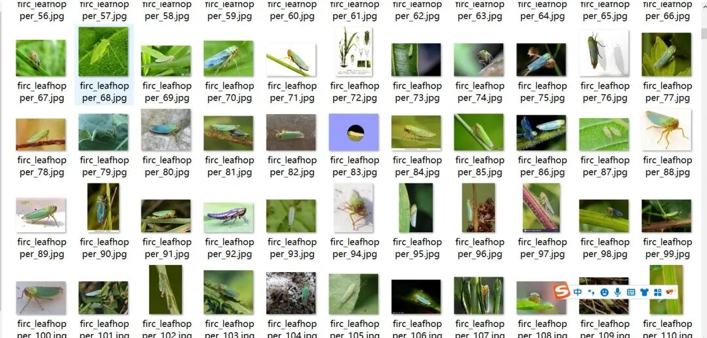
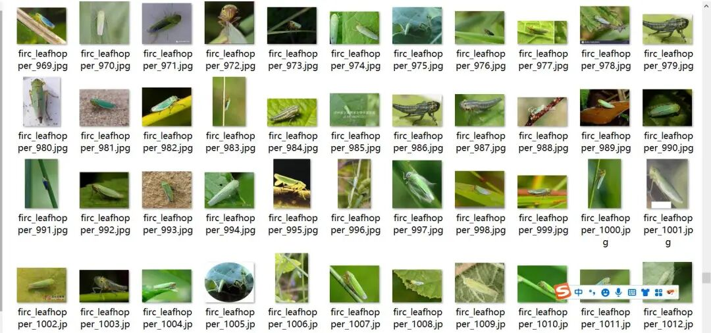
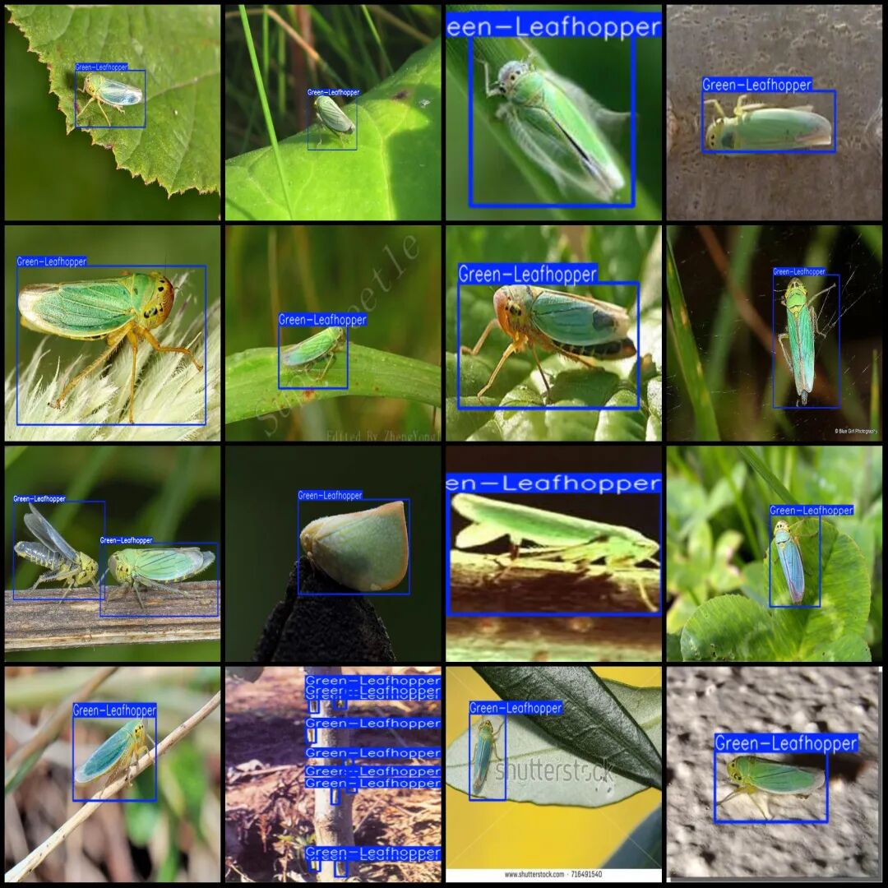

# Agricultural Pests Detection Dataset for Little Greenhoppers in VOC+YOLO format with 1199 images and 1 category

Dataset format: Pascal VOC format + YOLO format (txt file without split path, only containing jpg images and corresponding VOC format xml files and yolo format txt files)

Number of images (number of jpg files): 1199

Number of annotations (number of xml files): 1199

Number of annotations (number of txt files): 1199

Label category count: 1

Label category name (Note that the order of categories in the yolo format does not correspond to this, but is based on the classes.txt file in the labels folder): ["Green-Leafhopper"]

Number of boxes labeled in each category:

Green-Leafhopper frame count = 1399

Total frame count: 1399

Image resolution: Multi-resolution, such as 600x400, 450x300, etc.

Using labelImg:

Annotation rules: Draw a rectangle around the category.

Important Notice: No

Special : This dataset does not guarantee the accuracy of the trained models or weight files.

Image Preview:

Annotation example:

## Payment

Here is a pay link on Stripe ( https://buy.stripe.com/3cs8yP7sY87d0vu9AB ). Please contact me lonlonago@foxmail.com after funding $89, and I will send you a complete data files , thank you!

